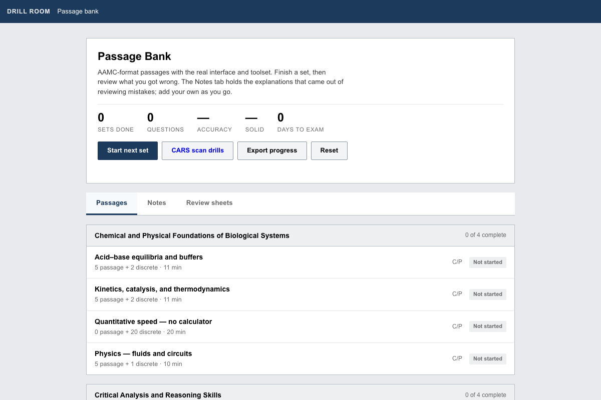

# Drill Room

Drill Room is an MCAT passage practice app that runs from a folder. It has its own passage sets and the tools I used to check that the questions were really fair, using the item-writing rules the real exam follows.

I made it for my own MCAT prep in 2026 and packaged it so my brother could run it. This is the version anyone can run.



## The app

**Use it in your browser: https://calvinslinde.github.io/drill-room/** (GitHub Pages serves the same `app/` folder). Or download the repository and open `app/index.html`, or serve the `app/` folder with `python3 -m http.server`. Either way everything is local: no accounts, nothing is sent anywhere, and progress is saved in your own browser.

- 22 passage sets across the four sections (B/B, C/P, P/S, CARS), in the real interface shape: a passage, six or so questions, a timer, review.
- The science passages are original, written to AAMC's published length and structure. The CARS passages are public-domain prose (Veblen, Boas, Addams, Pater) cut to AAMC length, with original questions.
- Each set carries per-choice reasoning (`app/whys.js`) and the explanations that came out of reviewing mistakes (`app/notes.js`).

Sets are plain JavaScript objects in `app/sets*.js` (`id`, `sec`, `topic`, `passage` as HTML, `questions`). Copy an existing one to add your own.

The "Review sheet" button expects page images of your own review notes in `app/sheets/` (`p001.jpg`, `p002.jpg`, ...). None are included; the button says so if they are missing.

## The quality tools

Items that can be answered without knowing the content train the wrong thing. These tools catch that, using the published item-writing rules the exam follows.

```
python3 tools/lint_items.py app        # bank-level surface cues: key position, length, grammar tells
python3 tools/flawcheck.py app         # NBME's 13 item-writing flaws, item by item
python3 tools/passagecheck.py app      # passage length and structure against measured AAMC parameters
python3 tools/plausibility.py app      # dead distractors (the largest single effect in the literature)
python3 tools/rebalance_keys.py app    # permute choices so the key is evenly distributed (rewrites files)
```

Run them on any folder of `sets*.js` files; with no argument they run on `app/`. No third-party question sets are included here.

`bash selftest.sh` runs the four checkers on the included bank and fails if any of them errors.

## The protocol

`PROTOCOL.md` is the study protocol the app serves, with the number behind each choice and the research notes it draws on in `research/` (successive relearning, learning versus testing, concept mapping, error review). `GENERATOR-SPEC.md` is the specification the science sets were written to.

## What is not here

My own scores, journals, and notes; passages owned by AAMC or Khan Academy; third-party review sheets.

## License

MIT. See `LICENSE`.
